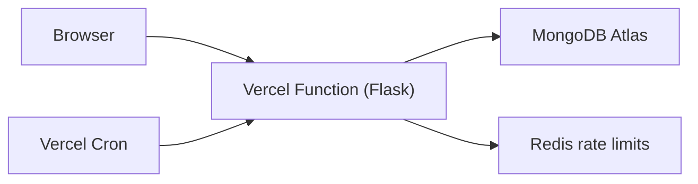

# Risk Sentinel

Risk Sentinel is a standalone Flask and MongoDB Atlas GRC risk management platform for identifying, assessing, treating, and reporting organizational risk.

## Features

- Role-based authentication for administrators, risk owners, and auditors
- Asset and risk registers with inherent/residual scoring
- ISO 27001 control mappings, treatment board, and audit trail
- Analytics dashboard, CSV export, and in-memory PDF risk reports
- MongoDB-backed lockout, shared rate limits, CSRF, security headers, and Vercel Cron overdue processing
- TOTP MFA for administrators and risk owners, SMTP verification/password recovery, and audited user administration

## Screenshots

_Screenshot placeholders: dashboard, risk register, treatment board, and PDF report._

## Architecture

## Tech stack

Python, Flask, Flask-WTF, Flask-Login, Flask-Limiter, ReportLab, PyMongo, MongoDB Atlas, Vercel, Redis, and self-hosted ECharts.

## Setup

Copy `.env.example` to `.env`, set a random `SECRET_KEY`, `MONGO_URI`, shared `RATELIMIT_STORAGE_URI`, and `CRON_SECRET`, then run `python run.py`. Create indexes explicitly with `python scripts/create_indexes.py`.

| Variable | Purpose |
|---|---|
| `FLASK_ENV` | `production` enables production checks |
| `SECRET_KEY` | Flask session signing |
| `MONGO_URI` | MongoDB Atlas connection |
| `RATELIMIT_STORAGE_URI` | Shared production rate-limit storage |
| `COOKIE_SECURE` | Secure browser cookies |
| `ALLOW_REGISTRATION` | Explicit public registration override |
| `CRON_SECRET` | Vercel Cron bearer secret |
| `SMTP_HOST` / `SMTP_PORT` | SMTP server and port for security email |
| `SMTP_USERNAME` / `SMTP_PASSWORD` | SMTP credentials |
| `SMTP_FROM` | Security email sender |

## Tests

Run `python -m pytest -q`.

## Demo access

Run `python scripts/seed_demo.py --confirm` locally. Set `DEMO_AUDITOR_PASSWORD` to provide the demo password, or the script generates and prints it once. Use `--force` only when non-demo risks already exist; use `--reset-demo --confirm` to remove only demo-marked documents. The demo auditor account is read-only: `demo-auditor@example.com`.

Live link: _placeholder_

## Documentation

[Design](docs/DESIGN.md) · [Deployment](docs/DEPLOY.md) · [Methodology](docs/METHODOLOGY.md) · [Access matrix](docs/ACCESS_MATRIX.md) · [Performance](docs/PERFORMANCE.md) · [Limitations](docs/LIMITATIONS.md) · [Security](SECURITY.md)
